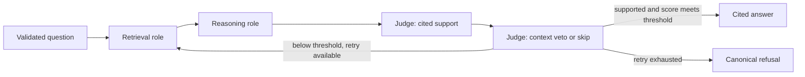

# V3: résumé-aligned workflow and local Llama

V3 implements three named LangGraph roles, a quality-triggered retrieval retry and FastAPI endpoints. These are role-specific workflow participants, not a claim of parallel autonomous workers. Stable v2.1 and its accepted 8.63/10 assessment remain historical baselines. V3 has not inherited that score or established a new answer-accuracy result.

## Initial machine assessment, 18 October 2026

| Item | Observed capability |
|---|---|
| Computer | Mac mini, Apple M4, 10 CPU cores and 10 GPU cores |
| Unified memory | 16 GiB |
| Free disk before this work | Approximately 21 GiB; approximately 17 GiB after dependency/index/model preparation |
| Initial LM Studio state | Installed, server off, only Nomic embedding weights present; no chat model |
| Installed chat model | Meta Llama 3.2 3B Instruct, LM Studio Community GGUF, Q4_K_M; 2,019,377,440 bytes |
| Model identity | SHA-256 `e4f1a04d927b09ec18eb2f233d85ecd760fc2d35cec97e37f8604d3632210d9a` |
| Selected runtime | Metal GPU offload, 8,192-token context, one simultaneous prediction |
| LM Studio estimate | 2.53 GiB total/GPU model memory |
| Observed load report | 1.88 GiB, loaded in 8.50 seconds; this is the model load report, not total application/system memory |

The initial 3B self-Judge subsequently failed broader development validation. It is retained as historical evidence, not the stable candidate. Keep the pinned BGE embedding/index pipeline; replacing it with the separately installed Nomic model would require a separately evaluated index change.

The refinement downloaded **Meta Llama 3.1 8B Instruct Q4_K_M**, 4,920,739,168 bytes, SHA-256 `f2be3e1a239c12c9f3f01a962b11fb2807f8032fdb63b0a5502ea42ddef55e44`. With 8,192-token context, full GPU offload and one prediction, LM Studio estimated **5.44 GiB** and reported **4.58 GiB**, loading in **2.56 seconds**. System memory-free readings during preliminary native controls were 41–53%; these are observations, not a full peak-memory/load test. Only one local chat model is loaded at a time. Keep 70B-scale inference hosted.

The 8B self-Judge still failed controls: 10/15 passed, 13 scored and two protocol gaps. The selected candidate therefore uses **local 8B Llama Reasoning with a Groq Qwen Judge**, which passed 15/15 inspected development controls after the quote/causal-support repairs. This is a profile-selection result, not broad answer accuracy. See the [ongoing stability assessment](../evals/V3_STABILITY_SCORECARD.md).

After the rejected trials, the upgrade's downloaded 3B Llama and Qwen3-4B-Instruct weights were hash-verified and removed, recovering 4.21 GiB and leaving approximately **12.28 GiB free**. The selected 8B Llama and the pre-existing Nomic embedding model remain. [Cleanup record](../evals/results/v3_model_cleanup.json). Earlier trial measurements remain historical; reproducing those rejected models requires downloading their recorded weights again.

## What is implemented



- [graph_v3.py](../graph_v3.py) owns the three named roles and explicit state handoff. Maximum two retrieval/generation attempts means at most one semantic retrieval retry.
- Judge returns `passed`, `confidence`, `reason`, literal evidence quotes and a missing-aspect query. `confidence` is an **uncalibrated rubric quality score**, not the probability that the answer is correct. The initial threshold is 0.8; it is configurable and fingerprinted, not an empirically optimized accuracy threshold.
- Retry combines the original question with the missing aspect and excludes previously retrieved chunk IDs when obtaining fresh evidence. Fresh and retained evidence share the existing 12-chunk/8,000-document-text-character input cap. Per-attempt history retains queries, documents, drafts, citations and verdicts.
- High scores cannot override a failed semantic support verdict or invalid citations/quotes. Persistent malformed outputs and provider outages remain errors. Failed final quality produces `I don't know.` with no citations.
- The Judge first checks cited support, then permits background context only to veto acceptance or lower the score. Both verdicts are retained in attempt history. Completed cited-support work has its own checkpoint so a later context outage does not repeat that paid assessment. The final API quality value keeps the more restrictive result; model rationales are fallible audit text.
- Existing generation/citation validation and quote-validation correction are reused through optional injected model chains. Calls from v0/v1/v2/v2.1 keep their default behavior. Dependency/code changes intentionally select new evaluation/index fingerprints.
- Evaluation retains v3 quality/history/attempt counts, model settings and local weight identity. Synchronous SQLite recovery preserves completed nodes. Local native evaluation requires `LMSTUDIO_MODEL_SHA256`; use a new model identifier/hash and restart when replacing weights behind an alias. The declared hash records operator-supplied provenance; the API cannot independently prove that a different server has loaded those same bytes.

## Provider reality: Llama and Groq are separate here

The live Groq account check returned 404 for `llama-3.3-70b-versatile`. Its currently accessible text model list contains GPT-OSS, Qwen, ALLAM and Llama Prompt Guard classifiers, but **no generative Llama model**. Prompt Guard is not an answer-generator substitute.

The [refreshed account catalog](../evals/results/v3_current_provider_catalog.json), checked again at 19:56 UTC on 18 October, confirms the same distinction; it contains model IDs only.

Therefore the working profiles are:

| Profile | Reasoning / Judge | Output protocol |
|---|---|---|
| Default hybrid candidate | Llama 3.1 8B through LM Studio / Qwen3.8-27B through Groq | Local JSON schema / cloud JSON object mode, then Pydantic and literal evidence checks |
| Groq | GPT-OSS-120B / Qwen3.8-27B | JSON object mode with explicit schema instructions, then Pydantic and literal evidence checks |
| Experimental all-local | Same loaded Llama model for both roles | JSON schema; the inspected 3B/8B self-Judges failed controls and are not promoted |

Groq Llama configuration is supported through `QA_MODEL` and `QA_JUDGE_MODEL` **if the account actually offers an answering Llama model**. It was not verified on this account. Do not describe the tested local Llama as Groq-hosted Llama. Provider availability, structured output and semantic reliability are different requirements.

## Run locally

```sh
uv sync --frozen
./fetch_corpus.sh
uv run python ingest.py

lms server start --port 1234 --bind 127.0.0.1
# Already downloaded on the inspected Mac. On another device, download once:
lms get https://huggingface.co/lmstudio-community/Meta-Llama-3.1-8B-Instruct-GGUF/resolve/main/Meta-Llama-3.1-8B-Instruct-Q4_K_M.gguf --yes
lms load meta-llama-3.1-8b-instruct --context-length 8192 --gpu max --parallel 1 --identifier llama-3.1-8b-instruct --ttl 3600

LANGSMITH_TRACING=false QA_BACKEND=lmstudio QA_MODEL=llama-3.1-8b-instruct \
  QA_JUDGE_BACKEND=groq QA_JUDGE_MODEL=qwen/qwen3.8-27b \
  uv run uvicorn api:app --host 127.0.0.1 --port 8000
```

Open `http://127.0.0.1:8000/docs` for the interactive API documentation. `GET /health` checks the API process only, not corpus/provider readiness. `POST /ask` accepts:

```json
{"question": "What is the default Namespace name in Temporal?"}
```

The response includes answer/refusal, canonical citations, quality verdict, attempt count, provider/model profile, elapsed time and reported usage. Empty/oversized/non-text questions and extra request fields return 422. Concurrent inference returns 429; missing index, invalid pipeline output and backend failures have safe error codes. No raw provider exception bodies or keys are returned. Each request starts with fresh graph state; this is not conversational memory.

For the currently available Groq profile:

```sh
LANGSMITH_TRACING=false QA_BACKEND=groq QA_MODEL=openai/gpt-oss-120b \
  QA_JUDGE_MODEL=qwen/qwen3.8-27b uv run uvicorn api:app --host 127.0.0.1 --port 8000
```

Configure `GROQ_API_KEY` normally for the hybrid and cloud profiles. Existing `.env` values are preserved. `QA_JUDGE_BACKEND` selects the Judge independently of the Reasoner. Experimental fully local execution uses `QA_JUDGE_BACKEND=lmstudio`; the inspected self-Judges failed controls. Local evaluation requires a weight hash for each local role: `LMSTUDIO_MODEL_SHA256` and, for a different Judge model, `LMSTUDIO_JUDGE_MODEL_SHA256`. The same-model Judge inherits the Reasoner's hash. The LM Studio URL must be a loopback `/v1` endpoint without embedded credentials or query strings. Restart Python after changing a profile; model clients are cached. After the one-hour idle TTL unloads the model, repeat `lms load`; process health alone does not establish model readiness.

To retain local native evaluation identities, compute the SHA-256 of the actual loaded GGUF, set `LMSTUDIO_MODEL_SHA256` to it, and run the normal evaluator, for example `uv run python evals/run_eval.py graph_v3 1 --dataset evals/v3_private_smoke.jsonl`. That file is an inspected one-question smoke reference, not a benchmark. Full comparison must use a deliberately selected complete dataset.

The default candidate sends the question, proposed answer and cited public evidence to Groq for quality judging. Tracing can add another data flow when enabled. The evaluator also uses separately configured Groq correctness/faithfulness judges when model grading is needed; their model/retry/rate settings are fingerprinted separately from generation and the graph Judge. A broad evaluation is not an offline benchmark. Historical canonical unanswerable-refusal smokes were scored deterministically without an external evaluation-Judge call.

Switching back to stable v2.1 also restores its dependency lock and retrieval code. Run `uv sync --frozen` and `uv run python ingest.py` after switching branches to select the matching index manifest; old collections are preserved.

## Evidence and limits

- 176 tests pass locally, including five real corpus/index integration tests. Tests exercise score validation, low/high-score branches, actual fresh retrieval, retained cited evidence, the retry bound, forged quotes and altered URLs, durable node/control recovery, per-role routing/fingerprints, API validation, isolation, safe failures and concurrency. See the scorecard for each frozen verification scope.
- An isolated source snapshot also passed 171 offline tests with five integration tests deselected, without credentials, `.env`, corpus or index. It included the retained JSON evidence fixtures and reused the installed locked interpreter; this was not a fresh dependency installation or a Windows test.
- [Initial local native controls](../evals/results/v3_local_controls.json) retain four historical 3B outcomes. Broader controls subsequently rejected that self-Judge; the initial smoke is not independent accuracy certification.
- [Initial local HTTP smoke](../evals/results/v3_local_http_smoke.json) and [initial Groq HTTP smoke](../evals/results/v3_groq_http_smoke.json) retain actual outcomes for the earlier implementation/profiles. They do not establish current hybrid accuracy. Current validation belongs in the stability scorecard.
- The [initial verification record](../evals/results/v3_verification.json) and [historical native evaluator trace](../evals/results/verified/graph_v3/382007d5488a25f85565c47b31a247f6f58484a0daf4ccf1c69370166e61bdce/20261018T082905708564Z-d0d379f1/partial.jsonl) retain the original implementation: two 12-chunk attempts, six genuinely new retry chunks and a final private-fact refusal. Later repairs changed code fingerprints. This one inspected question establishes historical trace/retry behavior, not current answerable-question accuracy.
- An earlier preserved smoke attempt had stale top-level generation metadata despite correct nested local model settings. It is superseded by the final trace above; the verification record identifies it rather than rewriting historical evidence.
- Cold/warm caches, different models and different request paths prevent a causal performance comparison from these few observations.
- Grammar-constrained JSON does not establish semantic truth. A small self-judging model can still accept unsupported answers or refuse answerable ones. No general accuracy increase or calibrated confidence is claimed.
- Changed-code [Linux CI 39164202254](https://github.com/kuntalashivasairahul/MultiAgent_QA_System/actions/runs/39164202254) passed for `5f06e83`: 171 offline tests, fresh 14,414-document index and five integration tests. This verifies the changed dependency/source tree, not native model quality.
- Bind to loopback. Authentication, private-data filtering, multi-tenant isolation, hosted API deployment, load testing and Windows execution are not established by this development implementation.

## Next upgrade order

The [future upgrade plan](V3_UPGRADE_ROADMAP.md) gives acceptance criteria and a practical learning sequence. The candidate's 12-question native regression reproduced a wrong-operation acceptance despite earlier 15/15 fixed Judge controls. Promotion remains blocked pending repair and a complete rerun; controls and tests alone do not establish stability.

1. **Measure the delivered v3.** Freeze provider, weights, threshold and retrieval settings; compare v2.1 and v3 on the corrected development set. Report supported correctness, false refusals, unsupported answers, evidence added by retry, tokens and latency. Then author fresh confirmation questions. Do not resume the old 9/10 goal automatically.
2. **Finish profile comparison and source review.** The inspected 3B/8B self-Judges were insufficient; the hybrid candidate must earn its broader result. Report quality, false refusals, protocol gaps, latency and reported usage. Model and prompt changes are bundled, so do not attribute gains to retrieval retry alone.
3. **Verify delivery environments.** Run changed-code CI, test the Windows presentation machine, and package reproducible local startup. Add authentication/deployment only when those become explicit requirements.

## Résumé wording after this implementation

**Multi-Agent QA System — LangGraph, FastAPI, Groq, LM Studio, Meta Llama, Python**

- Built a three-role Retrieval–Reasoning–Judge workflow in LangGraph, with structured quality scoring, cited-evidence checks and one bounded retrieval retry below a configurable threshold.
- Exposed the shared workflow through validated FastAPI REST endpoints; implemented local Meta Llama Reasoning through LM Studio with a Groq-hosted quality Judge, per-request state isolation and reproducible evaluation artifacts.

Use actual work dates. “Groq-hosted Llama” still requires an accessible model and native evidence on that provider; the current account does not supply it. Do not add an accuracy-improvement percentage from smoke tests.

## Primary references checked

- [LM Studio structured output](https://lmstudio.ai/docs/developer/openai-compat/structured-output): schema support and the warning that smaller models may struggle.
- [LM Studio Community Llama 3.2 3B model card](https://huggingface.co/lmstudio-community/Llama-3.2-3B-Instruct-GGUF): Meta base model and GGUF quantization provenance.
- [LM Studio Community Meta Llama 3.1 8B model card](https://huggingface.co/lmstudio-community/Meta-Llama-3.1-8B-Instruct-GGUF): the downloaded 8B model and quantization provenance.
- [Groq structured outputs and JSON object mode](https://console.groq.com/docs/structured-outputs): model-specific schema support; Llama JSON-object example. Actual account availability was checked through its models API.
