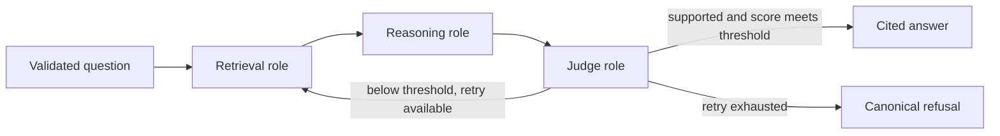

# V3: résumé-aligned workflow and local Llama

V3 implements three named LangGraph roles, a quality-triggered retrieval retry and FastAPI endpoints. These are role-specific workflow participants, not a claim of parallel autonomous workers. Stable v2.1 and its accepted 8.63/10 assessment remain historical baselines. V3 has not inherited that score or established a new answer-accuracy result.

## Machine assessment, 18 October 2026

| Item | Observed capability |
|---|---|
| Computer | Mac mini, Apple M4, 10 CPU cores and 10 GPU cores |
| Unified memory | 16 GiB |
| Free disk before this work | Approximately 21 GiB; approximately 17 GiB after dependency/index/model preparation |
| Initial LM Studio state | Installed, server off, only Nomic embedding weights present; no chat model |
| Installed chat model | Meta Llama 3.2 3B Instruct, LM Studio Community GGUF, Q4_K_M; 2,019,377,440 bytes |
| Model identity | SHA-256 `e4f1a04d927b09ec18eb2f233d85ecd760fc2d35cec97e37f8604d3632210d9a` |
| Selected runtime | Metal GPU offload, 8,192-token context, one simultaneous prediction |
| LM Studio estimate | 2.53 GiB total/GPU model memory |
| Observed load report | 1.88 GiB, loaded in 8.50 seconds; this is the model load report, not total application/system memory |

This is a practical local development setup. Run the three roles sequentially on one loaded model and keep API concurrency at one. Keep the pinned BGE embedding/index pipeline; replacing it with the separately installed Nomic model would require a separately evaluated index change.

A quantized 8B model is a later quality/performance candidate, not a tested recommendation for this machine. Estimate its memory at the chosen context before loading it, unload the 3B model first, and measure memory pressure and latency. Keep 70B-scale inference on a hosted service rather than planning it for this 16 GiB Mac. Do not download several large models into the limited free disk space without a concrete comparison to run.

## What is implemented



- [graph_v3.py](../graph_v3.py) owns the three named roles and explicit state handoff. Maximum two retrieval/generation attempts means at most one semantic retrieval retry.
- Judge returns `passed`, `confidence`, `reason`, literal evidence quotes and a missing-aspect query. `confidence` is an **uncalibrated rubric quality score**, not the probability that the answer is correct. The initial threshold is 0.8; it is configurable and fingerprinted, not an empirically optimized accuracy threshold.
- Retry combines the original question with the missing aspect and excludes previously retrieved chunk IDs when obtaining fresh evidence. Fresh and retained evidence share the existing 12-chunk/8,000-document-text-character input cap. Per-attempt history retains queries, documents, drafts, citations and verdicts.
- High scores cannot override a failed semantic support verdict or invalid citations/quotes. Persistent malformed outputs and provider outages remain errors. Failed final quality produces `I don't know.` with no citations.
- Existing generation/citation validation and quote-validation correction are reused through optional injected model chains. Calls from v0/v1/v2/v2.1 keep their default behavior. Dependency/code changes intentionally select new evaluation/index fingerprints.
- Evaluation retains v3 quality/history/attempt counts, model settings and local weight identity. Synchronous SQLite recovery preserves completed nodes. Local native evaluation requires `LMSTUDIO_MODEL_SHA256`; use a new model identifier/hash and restart when replacing weights behind an alias. The declared hash records operator-supplied provenance; the API cannot independently prove that a different server has loaded those same bytes.

## Provider reality: Llama and Groq are separate here

The live Groq account check returned 404 for `llama-3.3-70b-versatile`. Its currently accessible text model list contains GPT-OSS, Qwen, ALLAM and Llama Prompt Guard classifiers, but **no generative Llama model**. Prompt Guard is not an answer-generator substitute.

Therefore the working profiles are:

| Profile | Reasoning / Judge | Output protocol |
|---|---|---|
| Default local | Llama 3.2 3B through LM Studio for both roles | JSON schema through the OpenAI-compatible local endpoint, then Pydantic and literal evidence checks |
| Groq | GPT-OSS-120B / Qwen3.8-27B | JSON object mode with explicit schema instructions, then Pydantic and literal evidence checks |

Groq Llama configuration is supported through `QA_MODEL` and `QA_JUDGE_MODEL` **if the account actually offers an answering Llama model**. It was not verified on this account. Do not describe the tested local Llama as Groq-hosted Llama. Provider availability, structured output and semantic reliability are different requirements.

## Run locally

```sh
uv sync --frozen
./fetch_corpus.sh
uv run python ingest.py

lms server start --port 1234 --bind 127.0.0.1
# Already downloaded on the inspected Mac. On another device, download once:
lms get https://huggingface.co/lmstudio-community/Llama-3.2-3B-Instruct-GGUF/resolve/main/Llama-3.2-3B-Instruct-Q4_K_M.gguf --yes
lms load llama-3.2-3b-instruct --context-length 8192 --gpu max --parallel 1 --identifier llama-3.2-3b-instruct --ttl 3600

LANGSMITH_TRACING=false QA_BACKEND=lmstudio QA_MODEL=llama-3.2-3b-instruct \
  uv run uvicorn api:app --host 127.0.0.1 --port 8000
```

Open `http://127.0.0.1:8000/docs` for the interactive API documentation. `GET /health` checks the API process only, not corpus/provider readiness. `POST /ask` accepts:

```json
{"question": "What is the default Namespace name in Temporal?"}
```

The response includes answer/refusal, canonical citations, quality verdict, attempt count, provider/model profile, elapsed time and reported usage. Empty/oversized/non-text questions and extra request fields return 422. Concurrent inference returns 429; missing index, invalid pipeline output and backend failures have safe error codes. No raw provider exception bodies or keys are returned. Each request starts with fresh graph state; this is not conversational memory.

For the currently available Groq profile:

```sh
LANGSMITH_TRACING=false QA_BACKEND=groq QA_MODEL=openai/gpt-oss-120b \
  QA_JUDGE_MODEL=qwen/qwen3.8-27b uv run uvicorn api:app --host 127.0.0.1 --port 8000
```

Configure `GROQ_API_KEY` normally for that profile. Existing `.env` values are preserved. The local profile needs no Groq key. The LM Studio URL must be a loopback `/v1` endpoint without embedded credentials or query strings. Restart Python after changing a profile; model clients are cached.

To retain local native evaluation identities, compute the SHA-256 of the actual loaded GGUF, set `LMSTUDIO_MODEL_SHA256` to it, and run the normal evaluator, for example `uv run python evals/run_eval.py graph_v3 1 --dataset evals/v3_private_smoke.jsonl`. That file is an inspected one-question smoke reference, not a benchmark. Full comparison must use a deliberately selected complete dataset.

The graph and API can infer entirely locally. The existing evaluator still uses separately configured Groq correctness/faithfulness judges whenever model grading is needed; those grading inputs leave the machine. The canonical unanswerable-refusal smoke is scored deterministically and needed no external judge call. A broad evaluation is therefore not a fully offline benchmark.

Switching back to stable v2.1 also restores its dependency lock and retrieval code. Run `uv sync --frozen` and `uv run python ingest.py` after switching branches to select the matching index manifest; old collections are preserved.

## Evidence and limits

- 152 tests pass locally, including five real corpus/index integration tests. Tests exercise score validation, low/high-score branches, actual fresh retrieval, the retry bound, forged quotes, durable node recovery, profile fingerprints, API validation, isolation, safe failures and concurrency.
- An isolated source snapshot also passed 147 offline tests with five integration tests deselected, without credentials, `.env`, corpus or index. It reused the installed locked interpreter; this was not a fresh dependency installation or a Windows test.
- [Local native controls](../evals/results/v3_local_controls.json) retain all four development outcomes, model artifact identity, timing and usage. They are not independent accuracy certification.
- [Local HTTP smoke](../evals/results/v3_local_http_smoke.json) and [Groq HTTP smoke](../evals/results/v3_groq_http_smoke.json) retain actual HTTP outcomes and model profiles. Inspect their status/outcomes rather than assuming every request succeeded.
- [Verification record](../evals/results/v3_verification.json) consolidates checks and provenance. The [final native evaluator trace](../evals/results/verified/graph_v3/382007d5488a25f85565c47b31a247f6f58484a0daf4ccf1c69370166e61bdce/20261018T082905708564Z-d0d379f1/partial.jsonl) records two 12-chunk attempts, six genuinely new retry chunks and the final private-fact refusal. All recorded code hashes match this implementation. This one inspected question establishes trace/retry behavior, not answerable-question accuracy.
- An earlier preserved smoke attempt had stale top-level generation metadata despite correct nested local model settings. It is superseded by the final trace above; the verification record identifies it rather than rewriting historical evidence.
- Cold/warm caches, different models and different request paths prevent a causal performance comparison from these few observations.
- Grammar-constrained JSON does not establish semantic truth. A small self-judging model can still accept unsupported answers or refuse answerable ones. No general accuracy increase or calibrated confidence is claimed.
- Bind to loopback. Authentication, private-data filtering, multi-tenant isolation, hosted API deployment, load testing and Windows execution are not established by this development implementation. The stable v2.1 Linux CI result does not certify this changed dependency/code tree.

## Next upgrade order

1. **Measure the delivered v3.** Freeze provider, weights, threshold and retrieval settings; compare v2.1 and v3 on the corrected development set. Report supported correctness, false refusals, unsupported answers, evidence added by retry, tokens and latency. Then author fresh confirmation questions. Do not resume the old 9/10 goal automatically.
2. **Compare a quantized 8B model with 3B.** Use the same questions and context limit, one model at a time. Keep it only if its quality/latency/memory tradeoff is better. Evaluate a stronger hosted Judge separately if needed; record that documents then leave the machine.
3. **Verify delivery environments.** Run changed-code CI, test the Windows presentation machine, and package reproducible local startup. Add authentication/deployment only when those become explicit requirements.

## Résumé wording after this implementation

**Multi-Agent QA System — LangGraph, FastAPI, Groq, LM Studio, Meta Llama, Python**

- Built a three-role Retrieval–Reasoning–Judge workflow in LangGraph, with structured quality scoring, cited-evidence checks and one bounded retrieval retry below a configurable threshold.
- Exposed the shared workflow through validated FastAPI REST endpoints; implemented local Meta Llama inference through LM Studio and a configurable Groq backend, with per-request state isolation and reproducible evaluation artifacts.

Use actual work dates. “Groq-hosted Llama” still requires an accessible model and native evidence on that provider; the current account does not supply it. Do not add an accuracy-improvement percentage from smoke tests.

## Primary references checked

- [LM Studio structured output](https://lmstudio.ai/docs/developer/openai-compat/structured-output): schema support and the warning that smaller models may struggle.
- [LM Studio Community Llama 3.2 3B model card](https://huggingface.co/lmstudio-community/Llama-3.2-3B-Instruct-GGUF): Meta base model and GGUF quantization provenance.
- [Groq structured outputs and JSON object mode](https://console.groq.com/docs/structured-outputs): model-specific schema support; Llama JSON-object example. Actual account availability was checked through its models API.
